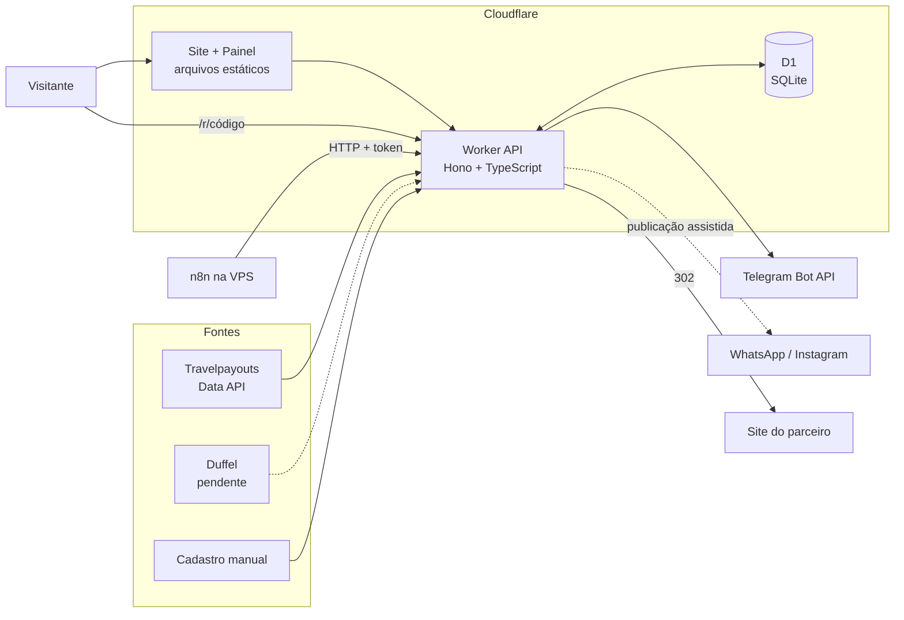

# 02 · Arquitetura

## Componentes

| Componente | Responsabilidade |
|---|---|
| **Adaptadores** (`src/adapters`) | Um arquivo por fornecedor com o contrato único `search()` + `status()`. Novo fornecedor = novo arquivo + uma linha no registro. |
| **Coleta** (`collect`) | Percorre as rotas ativas por prioridade, mês a mês, com teto de chamadas por execução (padrão 40) para respeitar limites e custos. |
| **Detecção** (`detect`) | Pontua cada preço novo contra o histórico comparável e cria oportunidades a partir de "Preço competitivo". |
| **Verificação** (`verify`) | Reconsulta a fonte. Sem confirmação dentro da tolerância, a oferta vira **desatualizada** e sai do ar. |
| **Expiração** (`expire`) | Tira do ar ofertas com partida no passado ou validade vencida. |
| **Montagem** (`compose`) | Cruza oportunidades com as regras de cada canal e cria rascunhos com link rastreável próprio. |
| **Envio** (`dispatch`) | Só posts aprovados, respeitando limite diário e horário de silêncio de cada canal. |
| **Link rastreável** (`/r/:code`) | Registra o clique (canal, oferta, parceiro, país) e redireciona. |

## Por que esta divisão

- **A lógica fica no código, a agenda fica no n8n.** O n8n decide *quando* rodar e *quem avisar*; o Worker decide *o que* fazer. Assim a regra de negócio tem versão, teste e revisão.
- **O Worker também tem agendador** (desligado por padrão). Se o n8n cair, basta ativar `[triggers]` no `wrangler.toml`.
- **Sem etapa de build no front-end.** HTML, CSS e JS são servidos como estão: menos peças para quebrar no MVP.

## Escala

| Gargalo | Quando aparece | Resposta |
|---|---|---|
| Chamadas à API de preços | Centenas de rotas × meses | Fila (Cloudflare Queues) e prioridade por rota; já existe teto por execução |
| Tamanho do histórico no D1 | Milhões de linhas | Agregar observações antigas por rota/semana; ou migrar para Postgres |
| Concorrência de escrita | Muitos cliques simultâneos | Gravar cliques em Analytics Engine ou fila e consolidar |

**Migração para Postgres:** o SQL usado é padrão. O esquema de `migrations/` converte quase sem mudanças (`AUTOINCREMENT` → `GENERATED ALWAYS AS IDENTITY`, `TEXT` de datas → `timestamptz`). No Worker, troca-se o cliente D1 por Hyperdrive + `postgres`.

## Expansão internacional

- Aeroportos do mundo inteiro já estão na base (3.245 com voo regular).
- Moeda é coluna própria em preços e oportunidades; o adaptador pede BRL hoje.
- Textos de post estão isolados em `lib/posts.ts`, prontos para versões em espanhol e inglês.
- Regiões seguem ISO 3166-2 (ex.: `BR-RN`, `AR-B`), então estados e províncias de outros países funcionam igual.

## Segurança

- Painel e jobs exigem `Authorization: Bearer <ADMIN_TOKEN>`. Em produção, colocar **Cloudflare Access** na frente de `/admin` e `/api/admin`.
- Segredos só via `wrangler secret put` (nunca no repositório).
- API pública só lê ofertas aprovadas e grava pesquisas, cadastros com consentimento e cliques.
